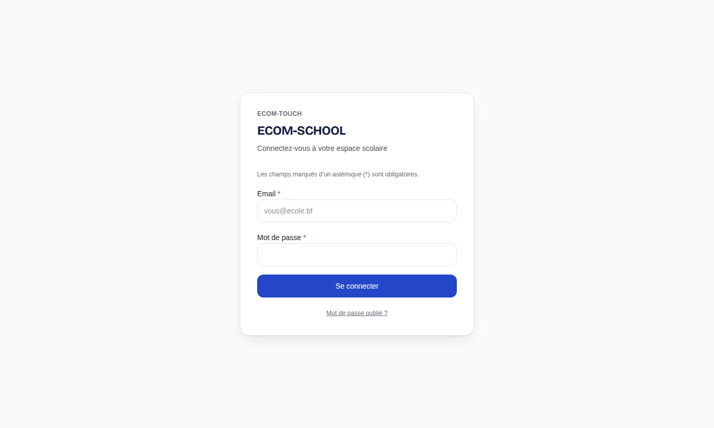
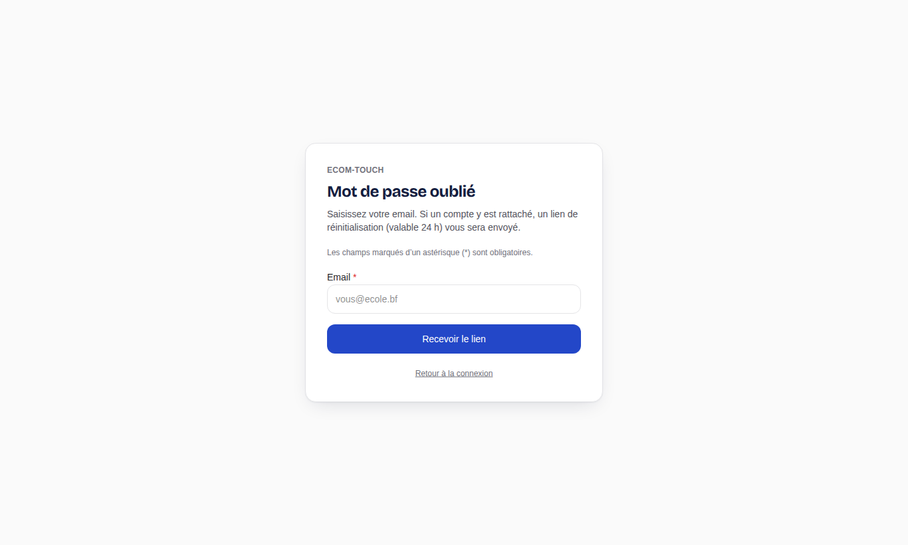
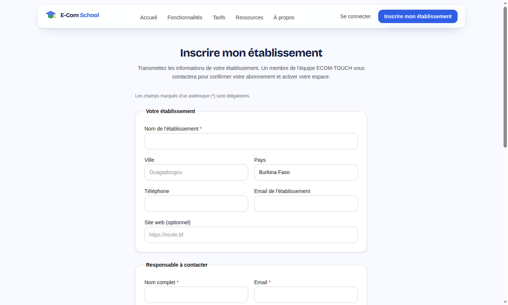

# 1. Prise en main

[← Sommaire](README.md)

## Se connecter

1. Ouvrez l'adresse de l'application et cliquez sur **Connexion** (page `/login`).
2. Saisissez votre **adresse email** et votre **mot de passe**, puis validez.
3. Vous arrivez directement dans l'espace correspondant à votre profil (établissement, enseignant, parent, élève ou plateforme).

Vos identifiants vous sont communiqués par l'établissement (ou par ECOM-TOUCH pour les administrateurs d'établissement). Pour vous déconnecter, utilisez le bouton **Déconnexion** en haut de l'écran.

## Activer son compte à partir d'une invitation

Lorsqu'un compte est créé pour vous, vous pouvez recevoir un lien d'invitation (`/invite/…`). Ouvrez-le, choisissez votre mot de passe et validez : le compte est activé et vous pouvez vous connecter. Un lien d'invitation a une durée de validité limitée ; s'il a expiré, demandez-en un nouveau à l'administrateur.

## Mot de passe oublié

1. Sur la page de connexion, cliquez sur **Mot de passe oublié** (page `/reset-password`).
2. Saisissez votre adresse email et validez.
3. Si un compte existe, un lien de réinitialisation est envoyé. Suivez-le pour définir un nouveau mot de passe.

L'administrateur de l'établissement peut aussi réinitialiser le mot de passe d'un utilisateur depuis **Administration → Utilisateurs** (bouton **Réinit. MDP**).

> L'envoi des emails dépend de la configuration de l'établissement. Si vous ne recevez rien, contactez l'administrateur.

## Se repérer dans l'espace établissement

Les profils de l'établissement (administration, finances, caisse) travaillent dans l'espace `/app`. Le menu latéral est organisé en sections :

| Section | Entrées (selon vos droits) |
| --- | --- |
| Pilotage | Tableau de bord, Annonces, Messagerie, Notifications |
| Établissement | Années scolaires, Niveaux, Classes, Matières, Salles, Emplois du temps, Enseignants |
| Pédagogie | Élèves, Parents, Inscriptions scolaires, Admissions, Réinscriptions, Notes, Moyennes, Bulletins, Délibérations, Règles de notation, Absences & retards |
| Finances | Finances, Dépenses, Comptabilité, Trésorerie, Rapports, Mobile Money, Guichet d'inscription, Mes encaissements |
| Administration | Documents, Demandes parents, Utilisateurs, Mon abonnement, Paramètres |

Une entrée n'apparaît que si votre rôle dispose de la permission correspondante. Les enseignants, parents et élèves disposent d'espaces simplifiés décrits dans leurs chapitres.

## Notifications

Les événements importants (bulletins publiés, absence enregistrée, paiement reçu, annonce…) génèrent des notifications :

- dans l'espace établissement, menu **Pilotage → Notifications** ;
- dans l'espace parent, un bandeau indique le nombre de notifications non lues, et l'onglet **Notifications** les liste.

Chaque utilisateur peut régler ses canaux de réception dans **Préférences** (`/app/preferences`) lorsque l'établissement a activé des canaux complémentaires (email, SMS, WhatsApp).

## Créer un établissement (nouveau client)

Un établissement qui souhaite utiliser ECOM-SCHOOL peut consulter les offres sur la page **Tarifs** (`/tarifs`) puis déposer une demande depuis **Inscription** (`/inscription`). La demande est étudiée par l'équipe ECOM-TOUCH, qui crée l'établissement et le premier compte administrateur (voir [chapitre 7](07-plateforme.md)).

