# 2. Direction et administration de l'établissement

[← Sommaire](README.md)

Ce chapitre s'adresse à l'**administrateur d'établissement** (direction, secrétariat de direction). C'est le profil le plus complet de l'espace établissement : il paramètre l'année, gère la scolarité, publie les résultats, administre les utilisateurs et suit l'abonnement. Les fonctions financières sont détaillées au [chapitre 3](03-finances-caisse.md).

## 2.1 Tableau de bord

Le **Tableau de bord** (`/app`) donne une vue d'ensemble : effectifs (élèves, enseignants, classes), situation financière (facturé, encaissé, reste à recouvrer), dernières annonces et inscriptions récentes.

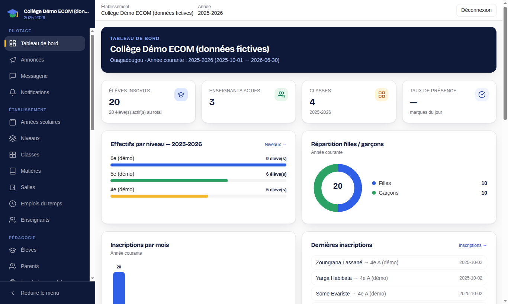

## 2.2 Démarrer une année scolaire

L'ordre conseillé pour préparer une rentrée est le suivant :

1. **Années scolaires** (`/app/academic-years`) : créez l'année (nom, dates de début et de fin), choisissez le découpage **Trimestres** ou **Semestres** et cochez **Définir comme année courante**. Le lien **Périodes** permet d'ajuster les dates de chaque trimestre/semestre.
2. **Niveaux** (`/app/levels`) : créez les niveaux (6e, 5e…).
3. **Matières** (`/app/subjects`) : créez les matières enseignées.
4. **Salles** (`/app/rooms`) : déclarez les salles et leur capacité.
5. **Classes** (`/app/classrooms`) : créez les classes de l'année, rattachées à un niveau. Dans la fiche d'une classe, ajoutez les matières avec leur **coefficient** et l'**enseignant** affecté.
6. **Enseignants** (`/app/teachers`) : créez les fiches enseignants et leurs affectations (classe, matière, année). Un export CSV/Excel des enseignants et affectations est disponible.
7. **Emplois du temps** (`/app/schedules`) : planifiez les cours.
8. **Règles de notation** (`/app/grading-policy`) : définissez les règles de calcul des moyennes (voir 2.6).

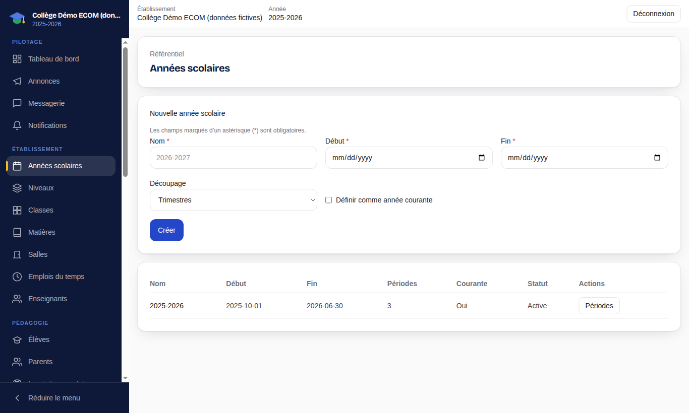

La fiche d'une classe regroupe : vue générale (capacité, élèves inscrits, enseignants affectés), matières et coefficients, emploi du temps, évaluations, taux de présence et absences de la classe. Une classe ou une fiche peut être **archivée** plutôt que supprimée, pour conserver l'historique.

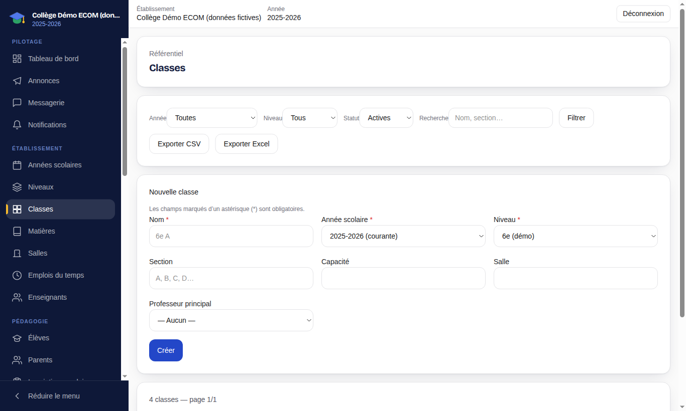

## 2.3 Élèves, parents et inscriptions

### Élèves

**Pédagogie → Élèves** (`/app/students`) liste les élèves avec recherche et filtres, et permet de créer, modifier, archiver une fiche et de l'exporter.

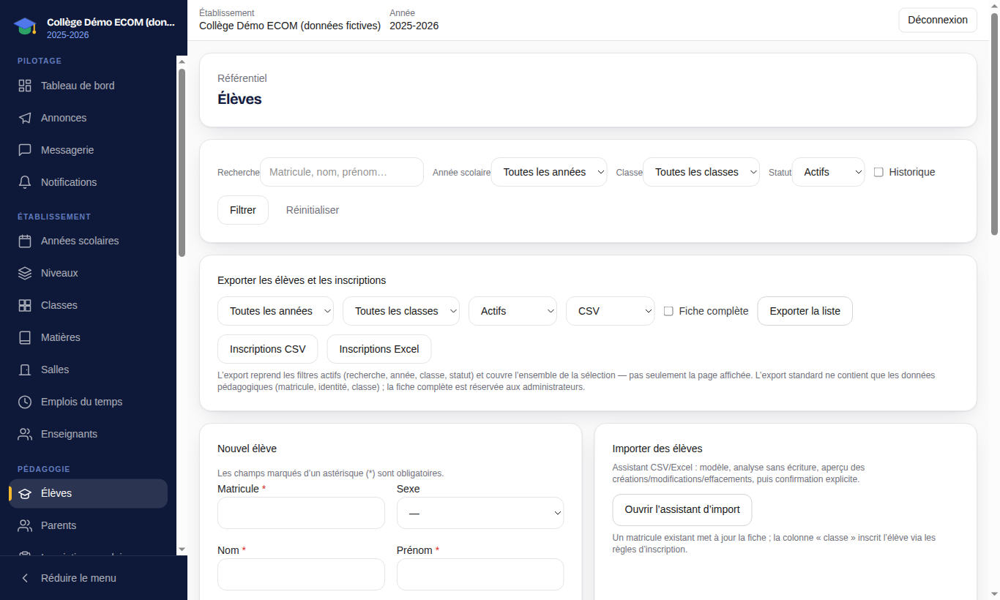

### Importer des élèves depuis un fichier

L'assistant **Importer** (`/app/students/import`) permet de créer ou mettre à jour des élèves en masse :

1. Téléchargez le **Modèle CSV** ou le **Modèle Excel**. Colonnes : `matricule;nom;prenom;sexe;date_naissance;lieu_naissance;telephone;email;adresse;classe`.
2. Remplissez-le. Une cellule vide conserve la valeur existante ; la valeur `__EFFACER__` efface explicitement le champ.
3. Choisissez l'**année scolaire** utilisée pour la colonne `classe`, déposez le fichier et cliquez sur **Analyser le fichier**.
4. Contrôlez l'aperçu : lignes à créer, à mettre à jour, et erreurs éventuelles ligne par ligne.
5. Confirmez l'import. Rien n'est enregistré avant cette confirmation.

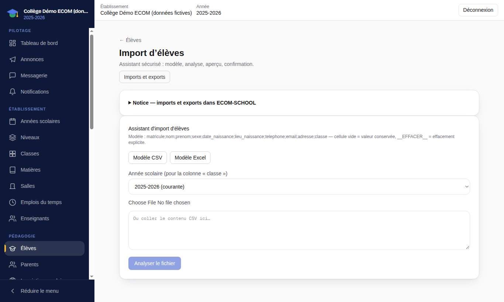

### Parents

**Pédagogie → Parents** (`/app/guardians`) gère les parents et tuteurs et leur rattachement aux élèves. Un parent rattaché et doté d'un compte voit ses enfants dans le portail parent.

### Inscriptions scolaires

**Inscriptions scolaires** (`/app/enrollments`) liste les inscriptions par année et par classe, avec les statuts **Inscrits**, **Transférés** et **Retirés**. C'est l'inscription qui place l'élève dans une classe pour une année donnée. Le **Guichet d'inscription** (chapitre 3) permet d'inscrire et d'encaisser en une seule démarche.

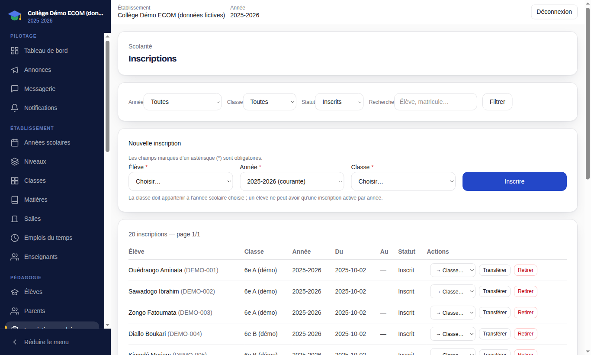

### Admissions (nouveaux élèves)

**Admissions** (`/app/admissions`) gère les candidatures des futurs élèves :

1. Dans **Campagnes** (`/app/admissions/campaigns`), créez une campagne (année, niveaux concernés, dates, pièces demandées) et ouvrez-la.
2. Les familles candidatent en ligne via la page publique de l'établissement (`/candidature/<identifiant-de-l-établissement>`) et suivent leur dossier depuis `/candidature/…/suivi`.
3. Le tableau de bord des admissions indique les candidatures nouvelles, incomplètes, en instruction, les entretiens à venir et les admis. Instruisez chaque dossier : demande de complément, entretien, décision.

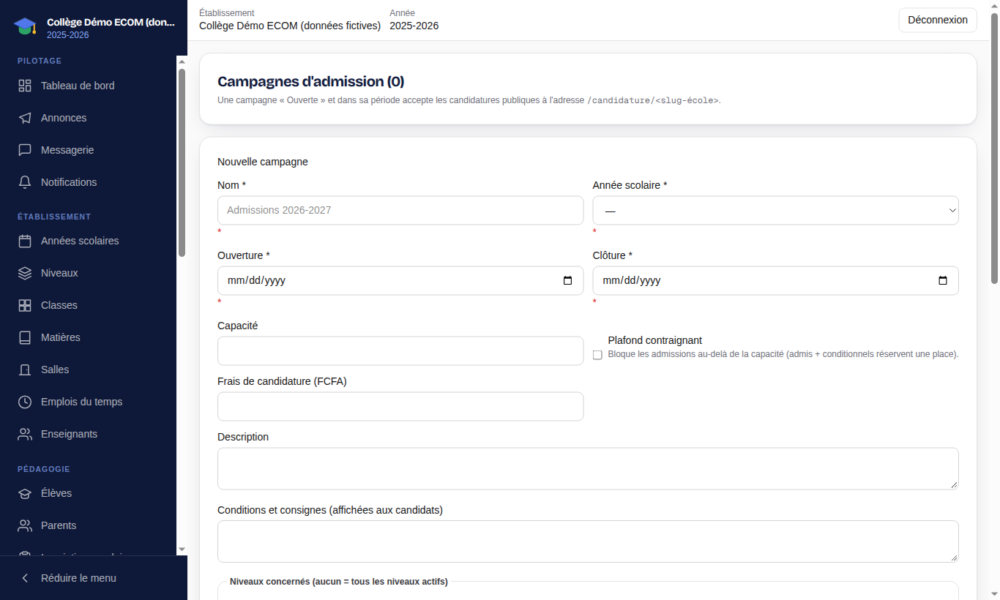

### Réinscriptions (élèves déjà scolarisés)

**Réinscriptions** (`/app/reinscriptions`) organise le renouvellement annuel :

1. Créez une **campagne de réinscription** (nom, année source, année cible, dates d'ouverture, message aux familles).
2. Les parents déposent la demande depuis l'onglet **Réinscription** du portail parent.
3. Instruisez chaque demande : passage au niveau supérieur, maintien, changement de classe ou de cycle, départ signalé. Les alertes (impayés sur l'année source, pièces obligatoires manquantes, conflit avec la décision annuelle) sont signalées. Vous pouvez demander un complément, ajouter une note interne, approuver ou refuser (avec motif), puis finaliser.

## 2.4 Emplois du temps et séances

**Emplois du temps** (`/app/schedules`) affiche la semaine (navigation **Sem. précédente / Sem. suivante**) avec une vue par **Établissement**, **Classe**, **Enseignant** ou **Salle**. Les exports **CSV**, **Excel** et **PDF** sont disponibles. Chaque cours planifié donne lieu à des **séances** sur lesquelles l'enseignant fait l'appel et remplit le cahier de textes.

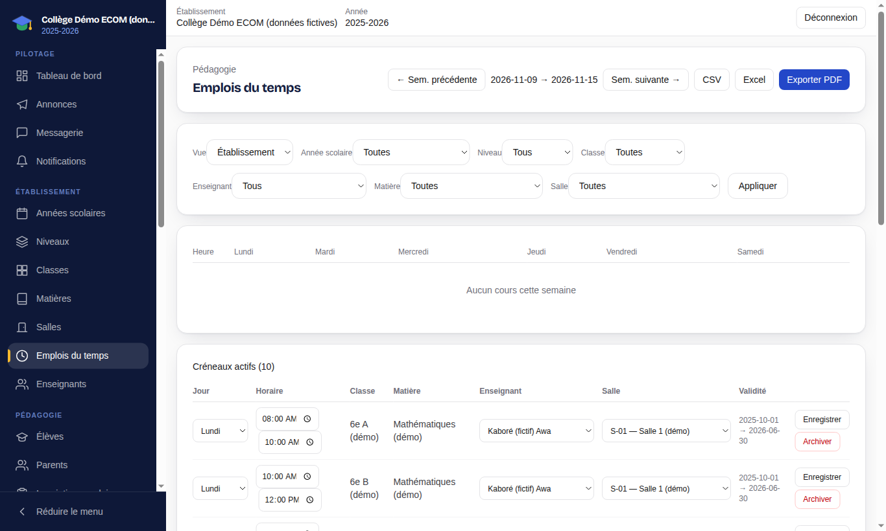

## 2.5 Absences et retards

**Absences & retards** (`/app/attendance`) permet :

- l'**appel journalier** : choisissez une classe et une date, puis **Charger** ;
- l'**enregistrement ponctuel** d'une absence ou d'un retard pour un élève ;
- la **justification** des absences (motif, pièce) et le suivi par classe et par élève.

Les absences enregistrées sont visibles par le parent et l'élève, et génèrent une notification au parent.

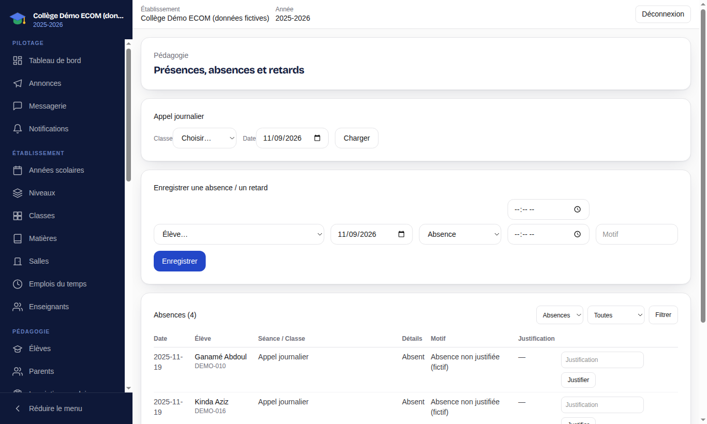

## 2.6 Notes, moyennes, bulletins et délibérations

Le circuit des résultats suit toujours la même logique : **saisie → publication des évaluations → calcul et validation des moyennes → bulletins → publication**.

### Règles de notation

**Règles de notation** (`/app/grading-policy`) définit, pour une année scolaire (et éventuellement un niveau) : arrondi, seuil de réussite, traitement des absences aux évaluations, mentions. Toute modification crée une **nouvelle version** : les bulletins déjà publiés conservent les règles en vigueur au moment de leur publication et ne sont jamais modifiés rétroactivement.

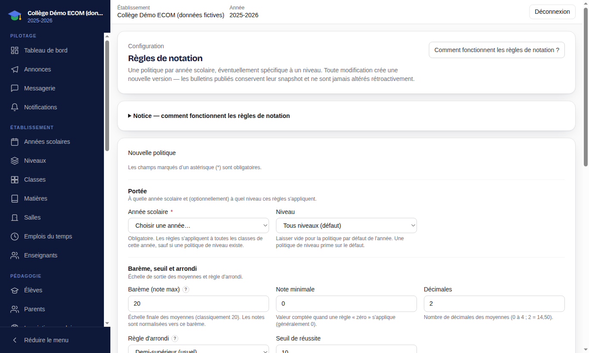

### Évaluations et notes

**Notes** (`/app/grades`) liste les évaluations (filtres par année, période, classe, matière, enseignant, statut). Pour créer une évaluation : titre, classe, matière, période, date, **note maximale** et coefficient. Dans le détail d'une évaluation :

- saisissez les notes élève par élève (une note hors barème est refusée) ou utilisez **Importer** pour charger un fichier CSV/Excel (analyse puis confirmation) ;
- cliquez sur **Publier l'évaluation** pour rendre les notes visibles aux parents et aux élèves ;
- une évaluation erronée peut être **annulée** (avec confirmation).

Les notes sont exportables (choix du **format d'export**).

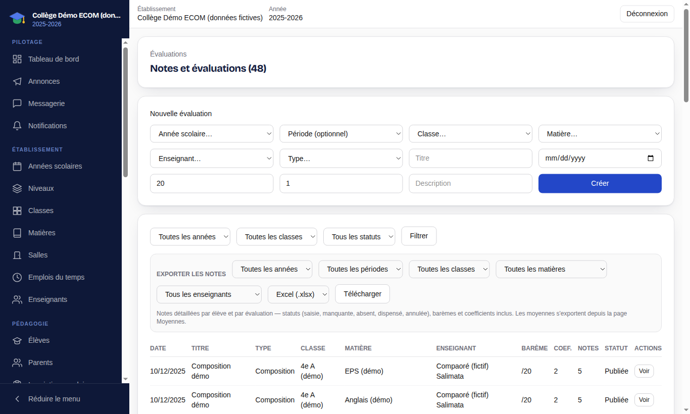

### Moyennes et résultats

**Moyennes** (`/app/averages`) calcule les moyennes par élève pour une classe et une période, avec les indicateurs de classe (meilleure et plus faible moyenne, élèves ayant la moyenne, taux de réussite) et les résultats annuels. Une fois contrôlés :

1. **Valider les résultats** ;
2. **Publier les résultats** — action **irréversible**, qui rend les résultats visibles sur les portails.

### Bulletins

**Bulletins** (`/app/report-cards`) :

1. Calculez d'abord les moyennes (l'écran le rappelle si ce n'est pas fait).
2. Cliquez sur **Générer les bulletins** pour la classe et la période choisies, puis confirmez.
3. Contrôlez, validez et publiez. Les bulletins publiés sont téléchargeables en **PDF** et visibles par les parents et les élèves.
4. En cas d'erreur sur un bulletin publié, utilisez **Rectifier le bulletin** en indiquant un **motif de rectification** : une nouvelle version est produite et l'historique est conservé.

Un export CSV de la liste des bulletins est disponible.

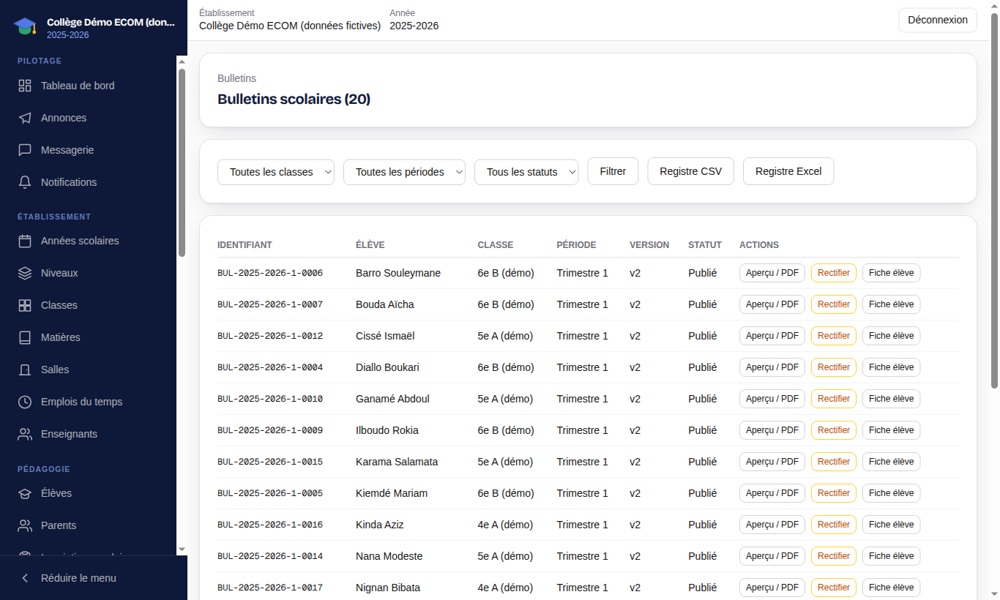

### Délibérations (conseils de classe)

**Délibérations** (`/app/deliberations`) prépare les décisions de fin de période ou d'année :

1. Ouvrez la délibération d'une classe : l'application propose une décision par élève selon les règles (**Recalculer les propositions** si les notes ont changé).
2. Le conseil peut **Ajuster** une proposition (cas « à trancher »).
3. **Valider et verrouiller**, puis **Publier les décisions**.
4. Si une correction est nécessaire : **Déverrouiller pour correction** ou **Retirer la publication**, avec un motif obligatoire.

## 2.7 Communication

### Annonces

**Annonces** (`/app/announcements`) : rédigez un **titre** (repris dans la notification) et un **contenu**, choisissez les **destinataires** (tous, parents, élèves, enseignants, une classe…), puis publiez immédiatement ou programmez la publication. Les annonces publiées apparaissent sur les portails des destinataires et déclenchent une notification ; les brouillons et annonces archivées ne sont jamais visibles.

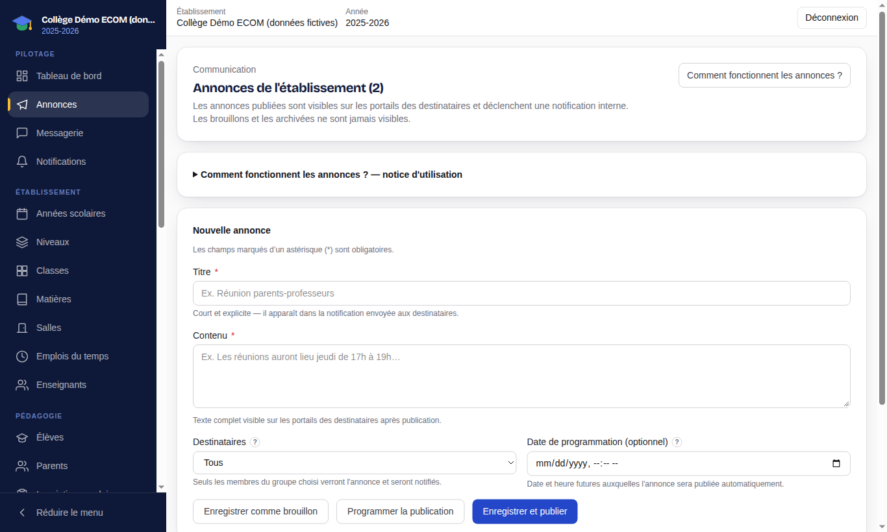

### Messagerie et notifications

**Messagerie** (`/app/messages`) permet d'échanger avec les familles et le personnel. **Notifications** liste les événements vous concernant. Les canaux complémentaires (email, SMS, WhatsApp) ne fonctionnent que si l'établissement les a configurés.

### Demandes des parents

**Demandes parents** (`/app/demandes`) centralise les demandes déposées depuis le portail parent (document administratif, justificatif d'absence, information, rendez-vous). Filtrez par statut (**Déposées, En cours, Traitées, Refusées, Annulées**), ouvrez une demande, répondez et changez son statut. Le traitement est manuel : chaque changement de statut est notifié au parent.

### Documents

**Documents** (`/app/documents`) stocke des documents privés rattachés aux élèves (identité, bulletin, justificatif, contrat, diplôme, administratif…). Formats acceptés : PDF, JPEG, PNG ; un quota de stockage par établissement est affiché. Les documents ne sont téléchargeables que depuis l'application, après contrôle d'accès. **Documents administratifs** (`/app/documents-administratifs`) produit les attestations et certificats à remettre aux familles.

## 2.8 Utilisateurs, rôles et paramètres

### Utilisateurs

**Utilisateurs** (`/app/users`) liste les comptes de l'établissement avec leur rôle et leur statut. Actions : **Nouvel utilisateur**, **Modifier**, **Réinit. MDP**, **Supprimer**, exports CSV/Excel. Le bouton **Comprendre les rôles** rappelle les permissions de chaque rôle.

Pour créer un compte (`/app/users/new`) : email, mot de passe initial, prénom, nom, statut (**Actif** / **Désactivé**) et rôle. Rôles disponibles dans l'établissement : administrateur (`ADMIN_SCHOOL`), responsable financier (`FINANCE_MANAGER`), caissier (`CASHIER`), enseignant (`TEACHER`), parent (`PARENT`), élève (`STUDENT`).

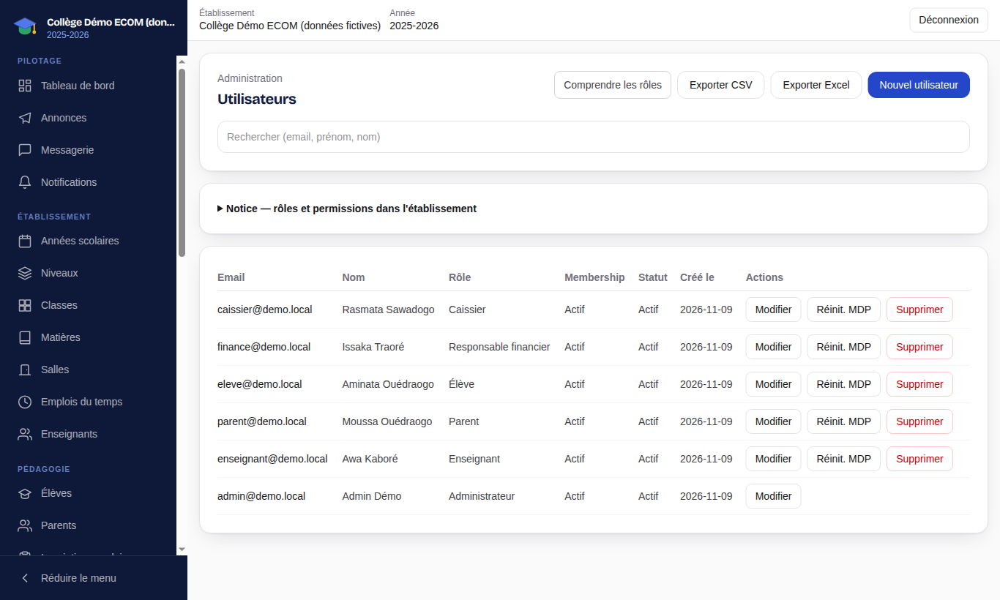

Bonnes pratiques : un compte par personne, désactiver plutôt que supprimer un compte de personnel qui part, et attribuer le rôle le plus restreint suffisant (par exemple **Caissier** pour un agent de guichet).

### Paramètres

**Paramètres** (`/app/settings`) : nom, logo, ville, adresse, téléphone, email, site web et type d'établissement. Ces informations apparaissent notamment sur les bulletins et les reçus.

## 2.9 Mon abonnement

**Mon abonnement** (`/app/subscription`) affiche l'offre souscrite (par exemple **Premium**), son statut, la périodicité de facturation, la prochaine échéance, les limites d'utilisation (nombre d'élèves et d'utilisateurs) et la liste des **modules disponibles**. Vous pouvez y demander un changement d'offre ; la demande est traitée par ECOM-TOUCH.

Un module non compris dans l'offre est inaccessible, même pour un administrateur. Si l'abonnement arrive à échéance, l'accès peut être restreint : surveillez la date de prochaine échéance.

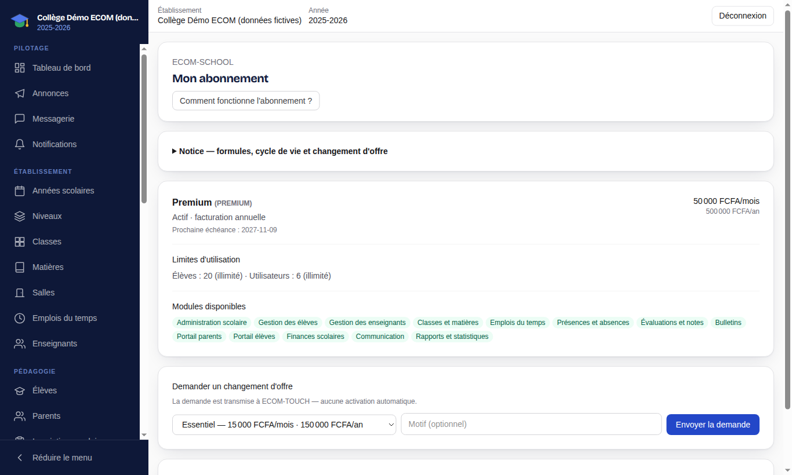
