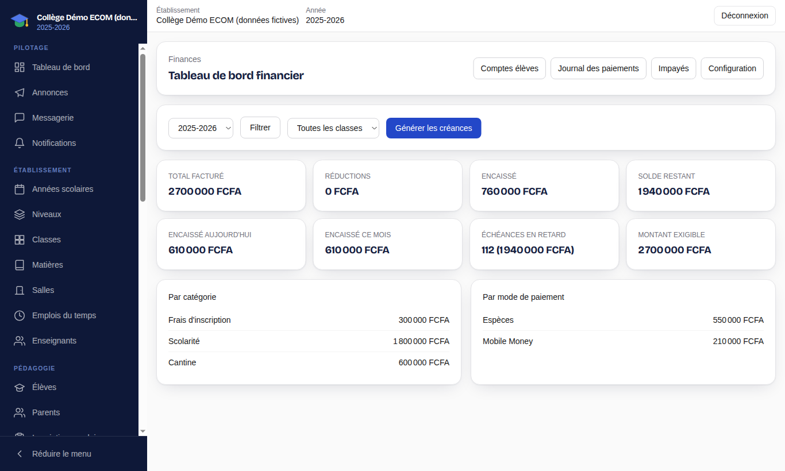
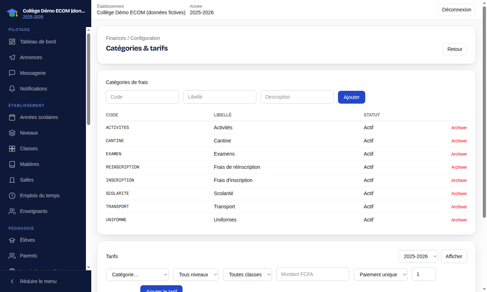
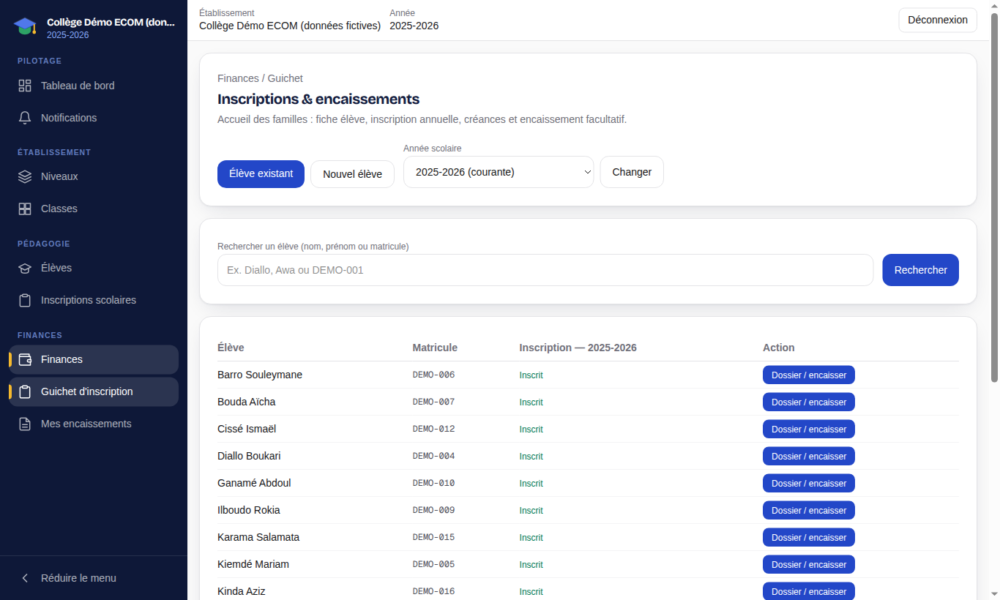
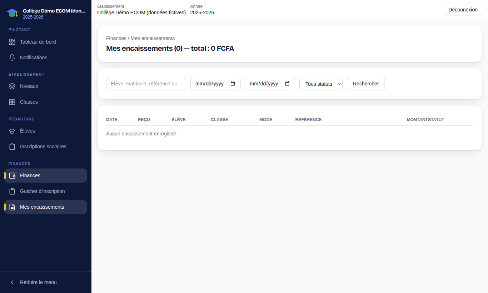
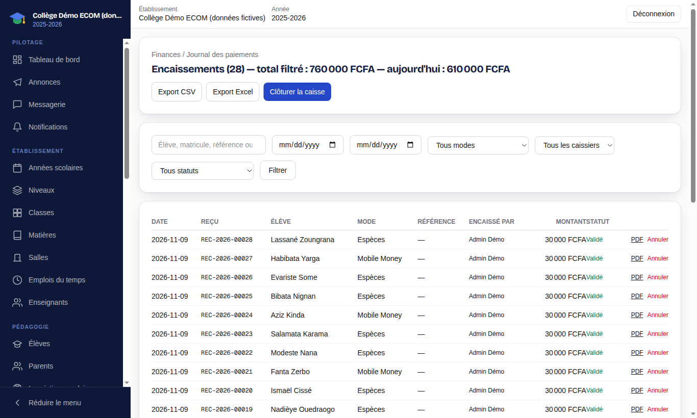
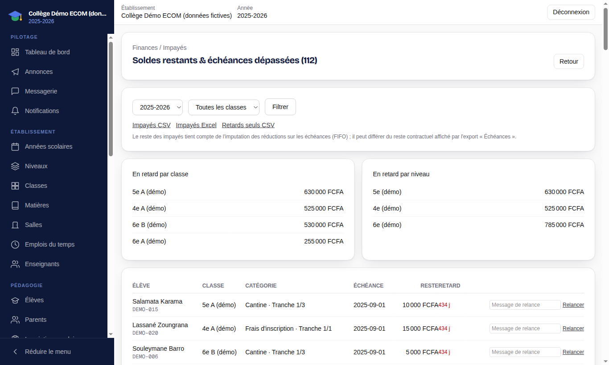
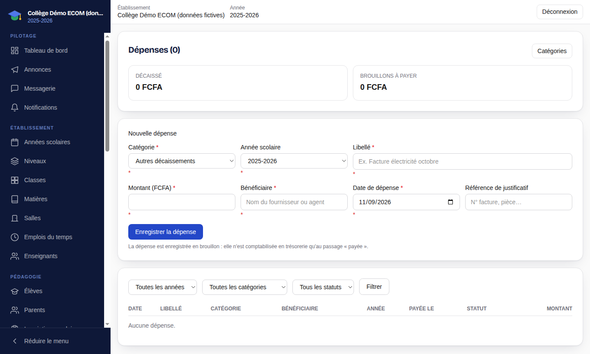
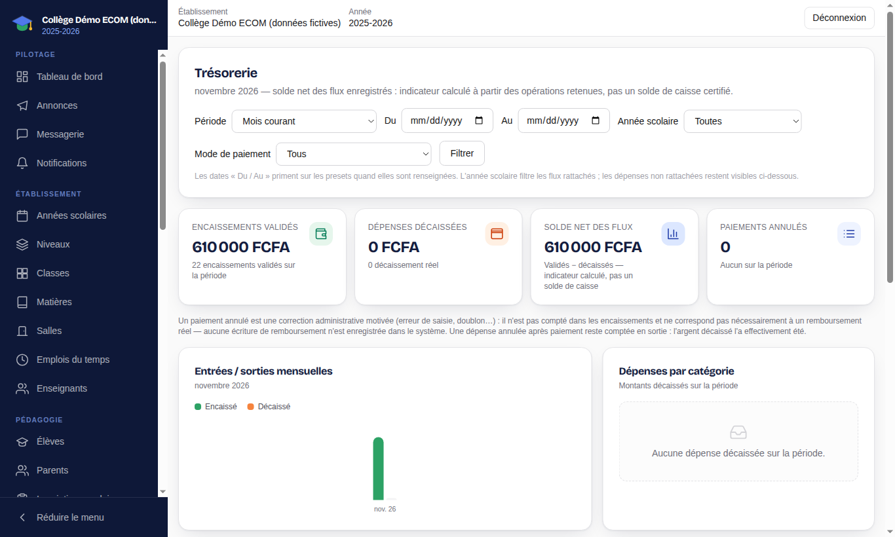
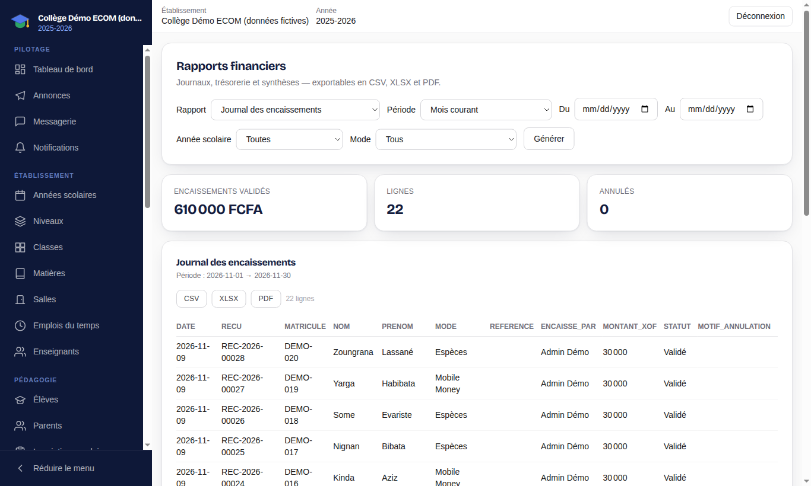

# 3. Finances et caisse

[← Sommaire](README.md)

Ce chapitre s'adresse au **responsable financier**, au **caissier** et à l'administrateur d'établissement pour la partie finances. Montants exprimés en FCFA.

| Fonction | Administrateur | Responsable financier | Caissier |
| --- | :---: | :---: | :---: |
| Tableau de bord financier, comptes élèves, impayés | Oui | Oui | Selon droits |
| Catégories et tarifs, génération des créances | Oui | Oui | Non |
| Guichet d'inscription, encaissement, reçu | Oui | Oui | Oui |
| Mes encaissements | Oui | Oui | Oui |
| Dépenses, trésorerie, rapports | Oui | Oui | Non |
| Comptabilité, Mobile Money | Oui | Selon droits | Non |

Les entrées du menu **Finances** s'affichent selon ces droits.

## 3.1 Tableau de bord financier

**Finances** (`/app/fees`) affiche pour l'année et la classe choisies : total facturé, réductions, encaissé et reste à recouvrer. Des onglets donnent accès aux **Comptes élèves**, au **Journal des paiements**, aux **Impayés** et à la **Configuration**.

## 3.2 Configurer les frais

1. **Configuration** (`/app/fees/settings`) : gérez les **catégories de frais** (scolarité, inscription, réinscription, cantine, transport, uniformes, examens, activités…). Une catégorie inutilisée s'**archive**.
2. Définissez les **tarifs** de l'année : montant par catégorie et par niveau ou classe, avec les **échéances** (dates et montants des versements).
3. Sur le tableau de bord financier, cliquez sur **Générer les créances** : chaque élève inscrit reçoit les montants dus selon les tarifs. L'opération peut être relancée après de nouvelles inscriptions.

## 3.3 Comptes élèves

**Comptes élèves** (`/app/fees/accounts`) liste, pour chaque élève : facturé, réductions, payé et solde. Exports **Comptes CSV/Excel** et **Échéances CSV/Excel**.

Le dossier d'un élève (`/app/fees/accounts/<élève>`) détaille ses créances et échéances, les **réductions** accordées (bourse, fratrie, remise…) et l'historique de ses paiements. On peut y enregistrer un encaissement.

> L'export « Échéances » montre le reste contractuel (montant moins encaissements ventilés). L'export « Impayés » montre le reste net après imputation des réductions sur les échéances les plus anciennes. Les deux chiffres peuvent donc différer.

## 3.4 Guichet d'inscription et encaissement (caissier)

Le **Guichet d'inscription** (`/app/fees/registration`) est l'écran d'accueil des familles : fiche élève, inscription annuelle, créances et encaissement en une seule démarche.

1. Vérifiez l'**année scolaire** (bouton **Changer** si besoin).
2. Choisissez **Élève existant** (recherche par nom, prénom ou matricule) ou **Nouvel élève** (création de la fiche).
3. Cliquez sur **Dossier / encaisser** : inscrivez l'élève dans sa classe si ce n'est pas fait, consultez ce qui reste dû.
4. Saisissez l'encaissement : montant, **mode de paiement** (espèces, virement, chèque, Mobile Money, autre) et référence le cas échéant. Le montant est réparti sur les échéances dues.
5. Validez puis imprimez ou remettez le **reçu**. Chaque reçu porte un numéro unique.

**Mes encaissements** (`/app/fees/my-payments`) liste les encaissements que vous avez saisis (date, reçu, élève, classe, mode, référence, montant, statut), avec filtre **Validés / Annulés** et recherche.

## 3.5 Journal des paiements et clôture de caisse

Le **Journal des paiements** (`/app/fees/payments`) regroupe tous les encaissements, filtrables par mode, caissier et statut (**Validés**, **En attente de vérification**, **Annulés**). Exports CSV et Excel.

- Un paiement erroné ne se supprime pas : il s'**annule** avec un motif, et reste visible dans le journal.
- Les paiements Mobile Money saisis manuellement (« MoMo — vérif. manuelle ») restent **en attente de vérification** jusqu'à confirmation.
- **Clôturer la caisse** arrête les encaissements d'une journée ou d'un caissier pour le contrôle.

## 3.6 Impayés et relances

**Impayés** (`/app/fees/unpaid`) liste les soldes restants et les échéances dépassées (élève, classe, catégorie, échéance, reste, retard), avec synthèses **En retard par classe** et **par niveau**. Exports **Impayés CSV/Excel** et **Retards seuls CSV** pour organiser les relances. Les parents voient de leur côté le détail des sommes dues dans l'onglet **Finances** de leur portail.

## 3.7 Dépenses

**Dépenses** (`/app/expenses`) enregistre les décaissements : catégorie (fonctionnement, fournitures et matériels, maintenance et services, salaires et indemnités, autres…), année scolaire, libellé, montant et bénéficiaire. Une dépense peut être enregistrée en **brouillon** puis marquée payée. Les catégories se gèrent depuis **Catégories** (`/app/expenses/categories`).

## 3.8 Trésorerie et rapports

**Trésorerie** (`/app/treasury`) présente les flux d'entrées et de sorties sur une période (mois courant, année civile, année scolaire ou dates libres), par mode de paiement. Le solde affiché est un indicateur calculé à partir des opérations enregistrées, pas un solde de caisse certifié.

**Rapports** (`/app/fees/reports`) produit, sur la période choisie : journal des encaissements, journal des dépenses, état de trésorerie, synthèse financière, dépenses par catégorie, encaissements par mode de paiement. Exports **CSV**, **XLSX** et **PDF**.

## 3.9 Comptabilité

**Comptabilité** (`/app/comptabilite`) génère des écritures comptables à partir des opérations réelles (encaissements, dépenses). À la première utilisation :

1. cliquez sur **Installer le plan SYSCOHADA** (plan de démarrage modifiable ensuite) ;
2. créez un **exercice comptable** (nom, dates) ;
3. comptabilisez les opérations en attente (compteur **À comptabiliser**), puis consultez journaux et écritures et exportez-les.

## 3.10 Mobile Money

**Mobile Money** (`/app/paiements-mobile`) suit les **intentions de paiement** initiées par les familles. Une intention n'est **pas** un encaissement : elle ne le devient qu'une fois confirmée puis comptabilisée. L'écran indique le nombre d'intentions, le montant cumulé, celles en attente et celles à comptabiliser ; **Balayer les intentions expirées** nettoie les intentions abandonnées.

Les fournisseurs de paiement doivent être configurés par l'établissement. Sans fournisseur réel, seul un **simulateur** peut être ajouté pour les essais ; en pratique, les paiements Mobile Money reçus hors application s'enregistrent au guichet avec le mode « MoMo — vérif. manuelle ».
