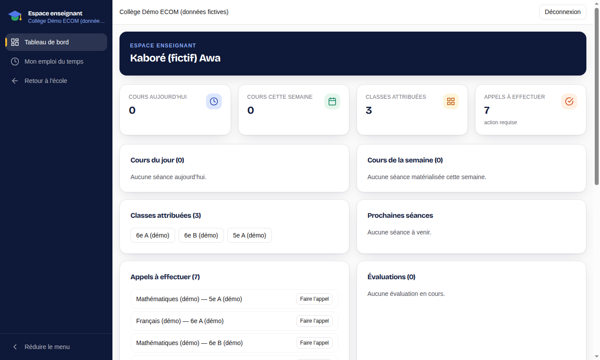
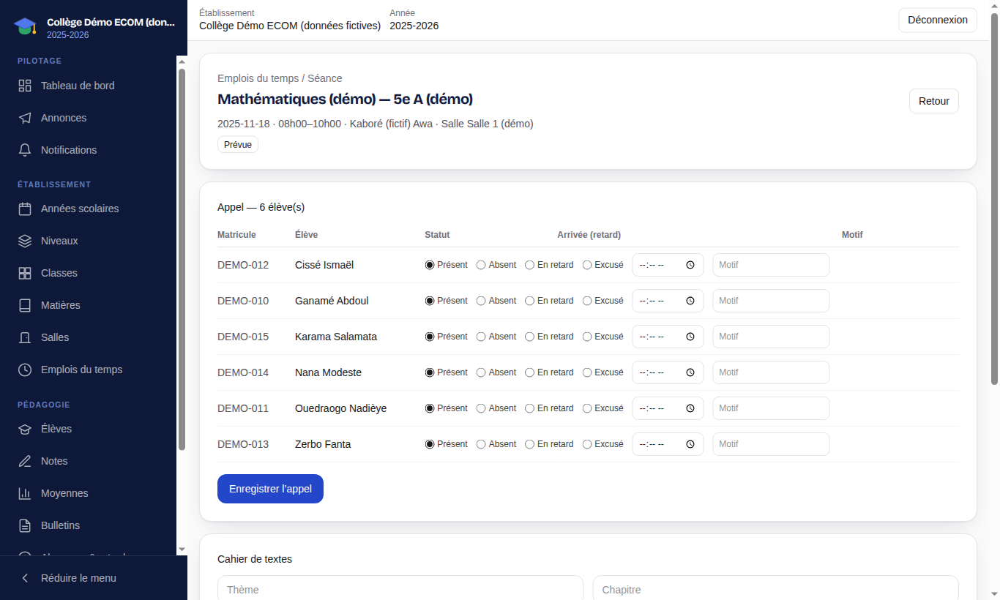
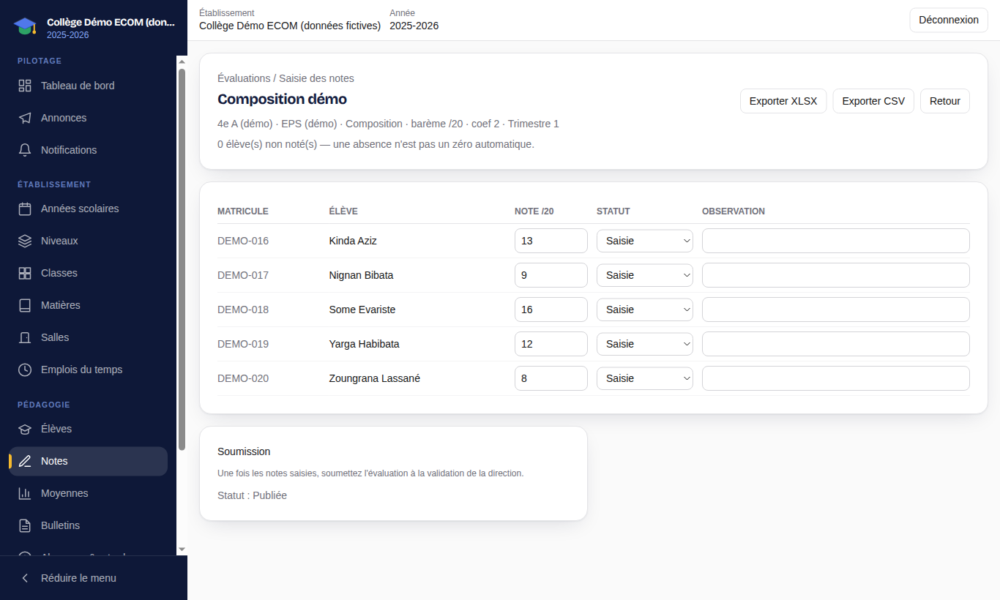

# 4. Enseignant

[← Sommaire](README.md)

Après connexion, l'enseignant arrive sur son **tableau de bord** (`/teacher`). Il ne voit que les classes, matières et élèves qui lui sont affectés.

## 4.1 Tableau de bord

Le tableau de bord présente :

- les **cours du jour** et **de la semaine** ;
- les **classes attribuées** ;
- les **appels à effectuer** (séances dont l'appel n'est pas encore fait) ;
- les **cahiers de textes à compléter** ;
- les **évaluations** en cours.

## 4.2 Faire l'appel et remplir le cahier de textes

1. Depuis le tableau de bord, ouvrez une séance (cours du jour ou appel à effectuer).
2. Dans le bloc **Appel**, chaque élève est **Présent** par défaut. Cochez **Absent**, **En retard** (avec l'heure d'arrivée) ou **Excusé**, ajoutez un **motif** si besoin, puis cliquez sur **Enregistrer l'appel**. Les parents des élèves absents sont notifiés.
3. Plus bas, complétez le **Cahier de textes** (thème, chapitre, contenu de la séance, travail à faire).

Le menu **Absences & retards** (`/app/attendance`) permet aussi de consulter les absences de ses classes.

## 4.3 Évaluations et notes

1. Menu **Notes** (`/app/grades`) : créez une évaluation (titre, classe, matière, période, date, note maximale, coefficient).
2. Ouvrez l'évaluation et saisissez les notes élève par élève. Une note supérieure à la note maximale est refusée. Vous pouvez aussi **Importer** un fichier CSV/Excel : l'application analyse le fichier, affiche un aperçu, puis enregistre après votre confirmation.
3. Quand la saisie est complète, cliquez sur **Publier l'évaluation** : les notes deviennent visibles pour les élèves et les parents.

Les moyennes, bulletins et délibérations sont ensuite produits et publiés par la direction (voir [chapitre 2](02-direction-etablissement.md#26-notes-moyennes-bulletins-et-délibérations)). L'enseignant peut consulter les bulletins de ses classes.
