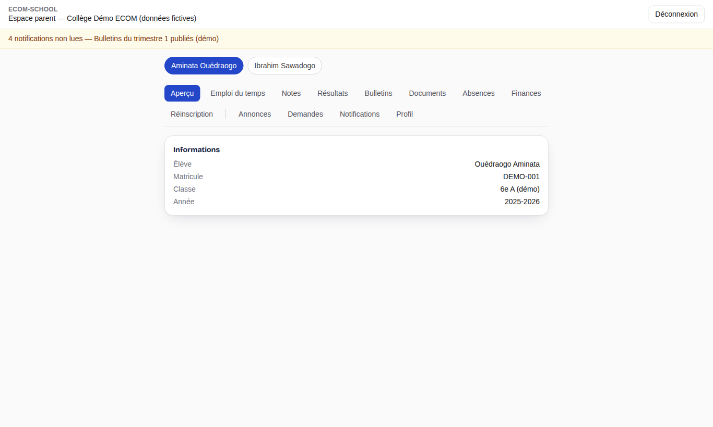
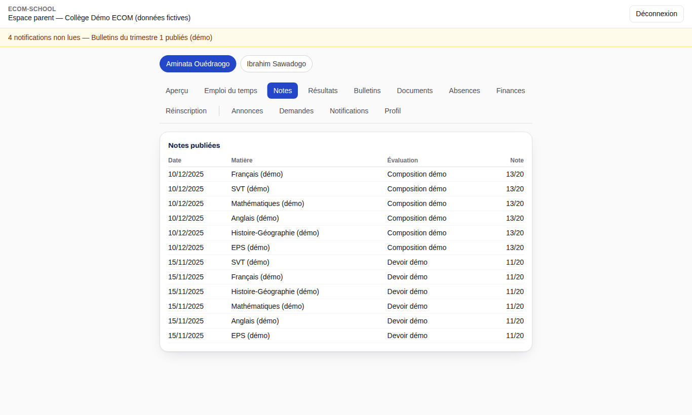
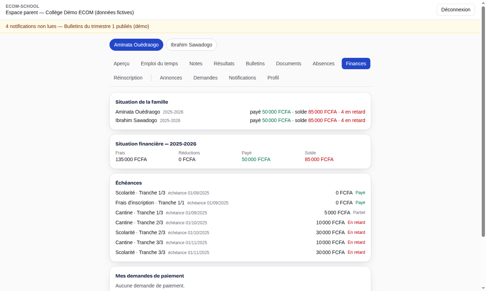
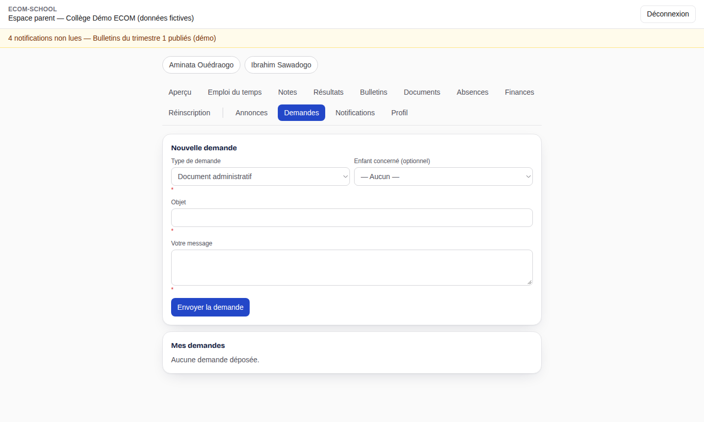

# 5. Parent

[← Sommaire](README.md)

Après connexion, le parent arrive sur son **espace parent** (`/parent`). Il voit uniquement les enfants qui lui sont rattachés par l'établissement.

## 5.1 Choisir un enfant

Si plusieurs enfants sont rattachés au compte, leurs prénoms apparaissent en haut de l'écran : cliquez sur un nom pour afficher ses informations. Le bandeau jaune indique les **notifications non lues**.

## 5.2 Les onglets

| Onglet | Contenu |
| --- | --- |
| Aperçu | Élève, matricule, classe et année scolaire |
| Emploi du temps | Cours de la semaine de l'enfant |
| Notes | Notes des évaluations publiées, par matière |
| Résultats | Moyennes et résultats publiés |
| Bulletins | Bulletins publiés, téléchargeables en PDF |
| Documents | Documents mis à disposition par l'établissement |
| Absences | Absences et retards, avec leur statut de justification |
| Finances | Sommes dues, échéances, paiements effectués et reçus |
| Réinscription | Demande de réinscription pour l'année suivante, quand une campagne est ouverte |
| Annonces | Annonces de l'établissement destinées aux parents ou à la classe |
| Demandes | Dépôt et suivi de demandes administratives |
| Notifications | Historique des notifications |
| Profil | Vos coordonnées et vos préférences |

Seules les informations **publiées** par l'établissement apparaissent : une note saisie mais non publiée, ou un bulletin en préparation, n'est pas encore visible.

## 5.3 Suivre les paiements

L'onglet **Finances** détaille, pour l'enfant sélectionné, les frais facturés, les réductions, les paiements enregistrés et le reste à payer avec les échéances. Les paiements sont enregistrés par l'établissement (guichet) ; conservez les reçus remis.

## 5.4 Faire une demande à l'établissement

1. Ouvrez l'onglet **Demandes**.
2. Choisissez le type de demande (document administratif, justificatif d'absence, information, rendez-vous), l'enfant concerné et décrivez votre demande.
3. Envoyez. Vous suivez ensuite son statut (**Déposée**, **En cours**, **Traitée**, **Refusée**) et recevez une notification à chaque changement. Une demande encore déposée peut être annulée.

## 5.5 Réinscrire son enfant

Lorsque l'établissement ouvre une campagne de réinscription, l'onglet **Réinscription** permet de confirmer la réinscription (ou de signaler un départ) et de fournir les pièces demandées. L'établissement instruit la demande et peut vous demander un complément.

## 5.6 Inscrire un nouvel enfant

Pour un enfant qui n'est pas encore scolarisé dans l'établissement, utilisez le lien de **candidature en ligne** communiqué par l'établissement (`/candidature/…`). Le suivi du dossier se fait depuis la page de suivi indiquée après le dépôt.
