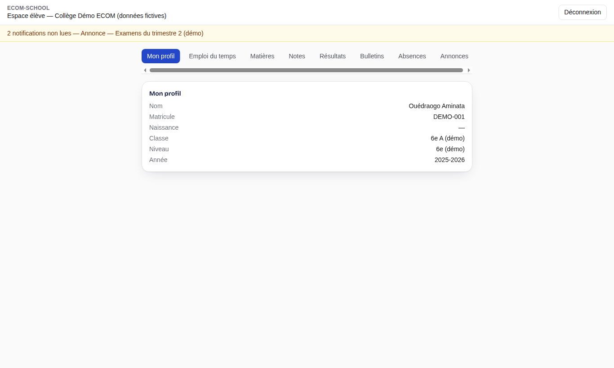
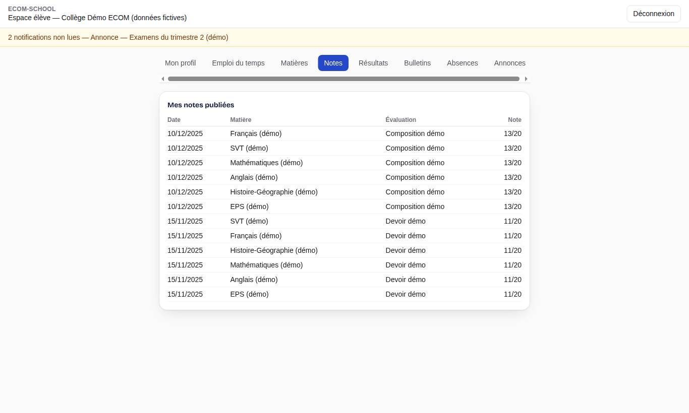

# 6. Élève

[← Sommaire](README.md)

Après connexion, l'élève arrive sur son **espace élève** (`/student`). Il ne voit que ses propres informations, et uniquement celles que l'établissement a publiées.

| Onglet | Contenu |
| --- | --- |
| Mon profil | Nom, matricule, classe, année scolaire |
| Emploi du temps | Cours de la semaine |
| Matières | Matières suivies, coefficients et enseignants |
| Notes | Notes des évaluations publiées |
| Résultats | Moyennes et résultats publiés |
| Bulletins | Bulletins publiés, téléchargeables en PDF |
| Absences | Absences et retards enregistrés |
| Annonces | Annonces destinées aux élèves ou à la classe |

En cas d'erreur sur une information (note, absence, identité), l'élève s'adresse à l'enseignant concerné ou à l'administration : l'espace élève est en consultation seule.
