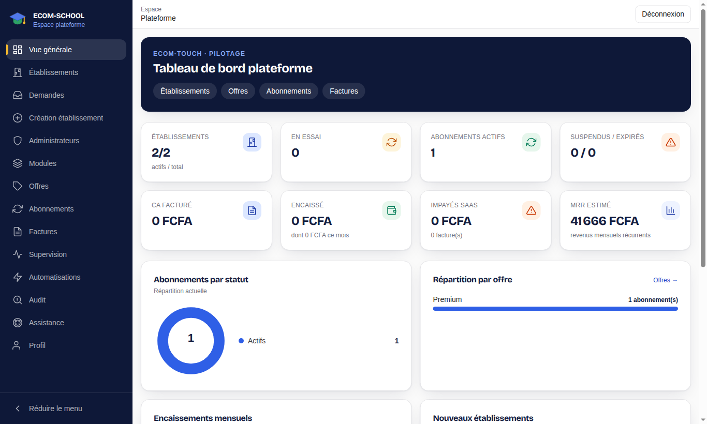
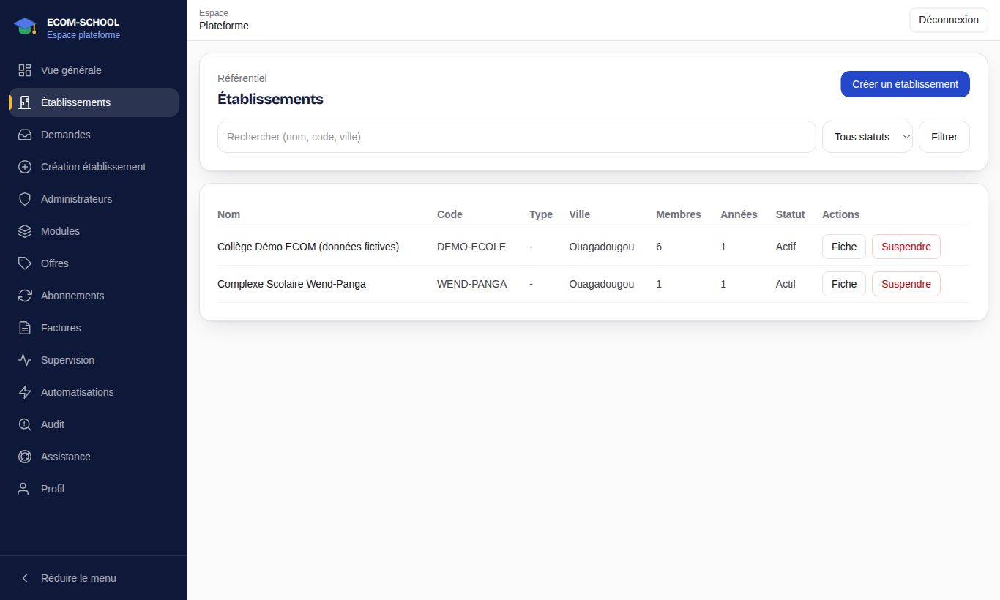
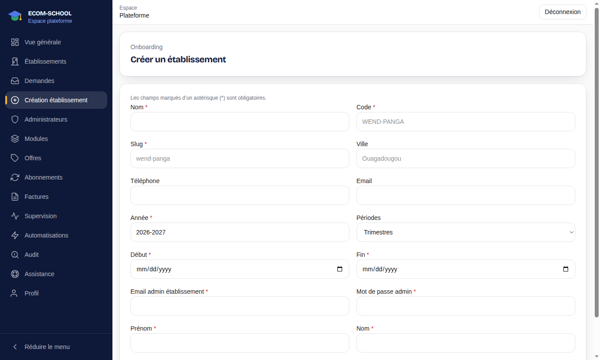
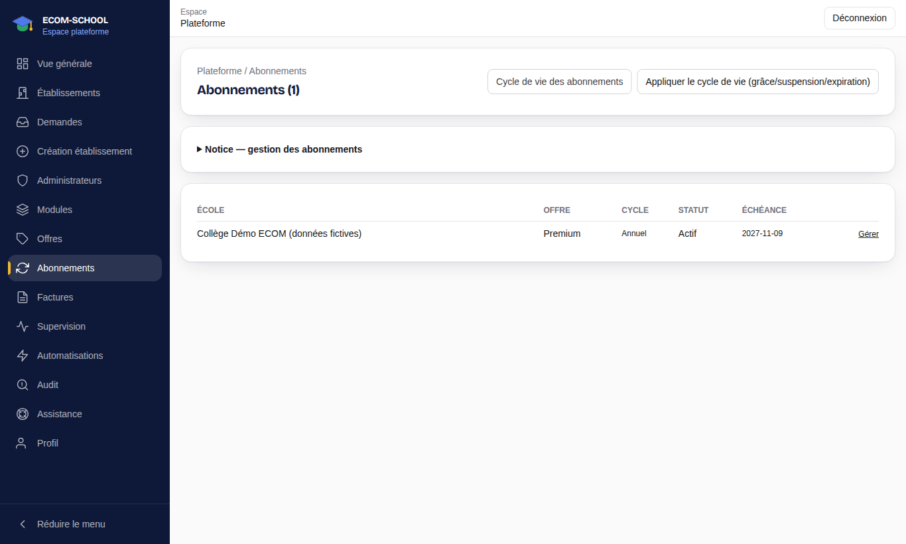
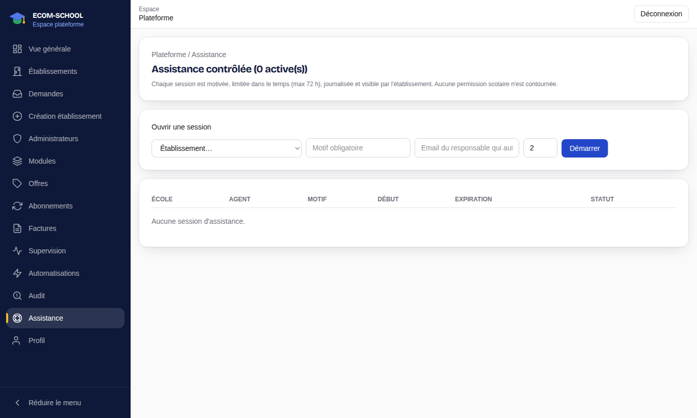

# 7. Plateforme ECOM-TOUCH

[← Sommaire](README.md)

Ce chapitre s'adresse à l'équipe ECOM-TOUCH qui exploite ECOM-SCHOOL pour le compte des établissements clients. L'espace plateforme (`/platform`) est séparé des espaces établissement.

| Profil | Accès |
| --- | --- |
| Propriétaire plateforme (`PLATFORM_OWNER`) | Tout l'espace plateforme |
| Commercial plateforme (`PLATFORM_SALES`) | Offres, modules, abonnements et factures ; pas de création d'établissement ni de gestion des administrateurs |

## 7.1 Vue générale

**Vue générale** (`/platform`) résume l'activité : établissements, abonnements, facturation et alertes.

## 7.2 Établissements clients

- **Établissements** (`/platform/schools`) : liste des établissements clients, leur statut et leur abonnement ; accès à la fiche de chaque établissement.
- **Demandes** (`/platform/signup-requests`) : demandes déposées depuis la page publique **Inscription**. Étudiez-les puis acceptez ou refusez.
- **Création établissement** (`/platform/onboarding`) : crée un établissement, son offre et son premier compte administrateur. L'administrateur reçoit ensuite ses accès et paramètre son établissement (voir [chapitre 2](02-direction-etablissement.md)).

## 7.3 Offres, modules et abonnements

- **Modules** (`/platform/modules`) : fonctionnalités activables (élèves, emplois du temps, notes, bulletins, finances, portail parents…).
- **Offres** (`/platform/plans`) : formules commerciales, avec leur prix mensuel/annuel, leurs limites (élèves, utilisateurs) et leurs modules.
- **Abonnements** (`/platform/subscriptions`) : abonnement de chaque établissement (offre, statut, échéance), traitement des demandes de changement d'offre, renouvellements et suspensions.
- **Factures** (`/platform/invoices`) : factures émises aux établissements et leur règlement.

Les modules d'un établissement découlent de son offre : un module retiré devient inaccessible dans l'établissement.

## 7.4 Exploitation

- **Administrateurs** (`/platform/administrators`) : comptes de l'équipe ECOM-TOUCH et leurs rôles.
- **Supervision** (`/platform/monitoring`) : état technique et indicateurs d'usage.
- **Automatisations** (`/platform/automations`) : tâches planifiées (relances, expirations, envois) et leur dernier passage.
- **Audit** (`/platform/audit`) : journal des actions sensibles.
- **Assistance** (`/platform/support`) : ouverture d'une **session d'assistance contrôlée** sur un établissement. Choisissez l'établissement, saisissez un **motif** (obligatoire), l'email du responsable de l'établissement qui l'autorise et une durée en heures (72 h maximum), puis **Démarrer**. Chaque session est journalisée et visible par l'établissement ; elle ne contourne aucune permission scolaire.
- **Profil** (`/platform/profile`) : votre compte.

