# Guide utilisateur — ECOM-SCHOOL

Les opérations quotidiennes, profil par profil. Captures réelles de
l'application (préproduction, données fictives).

## Connexion

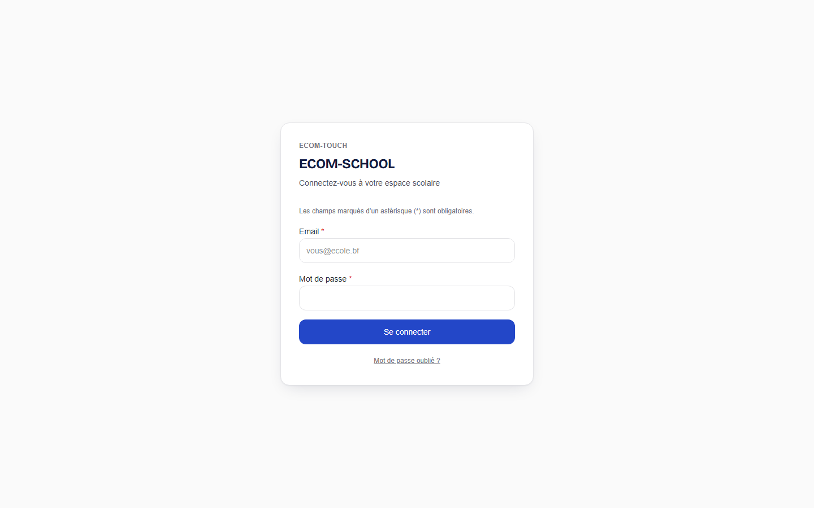

Saisissez l'adresse e-mail et le mot de passe reçus de votre
administration. Chaque compte ouvre l'espace correspondant à son rôle —
il est normal de ne pas voir les mêmes menus qu'un collègue.

## Direction / administrateur

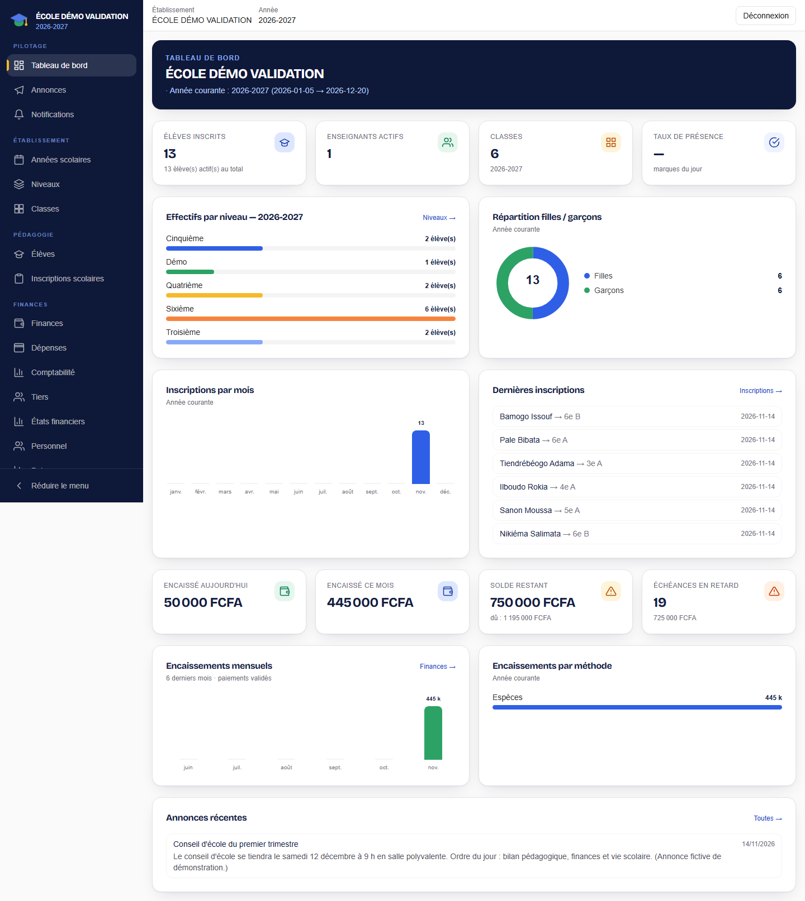

Le tableau de bord résume l'école : effectifs, répartition,
encaissements du jour et du mois, **solde restant dû**, échéances en
retard, annonces.

### Inscrire un élève

1. **Pédagogie → Élèves → Nouvel élève** : identité, matricule,
   responsables.
2. **Inscriptions scolaires → Inscrire** : choisir la classe — la
   créance de scolarité est générée automatiquement.

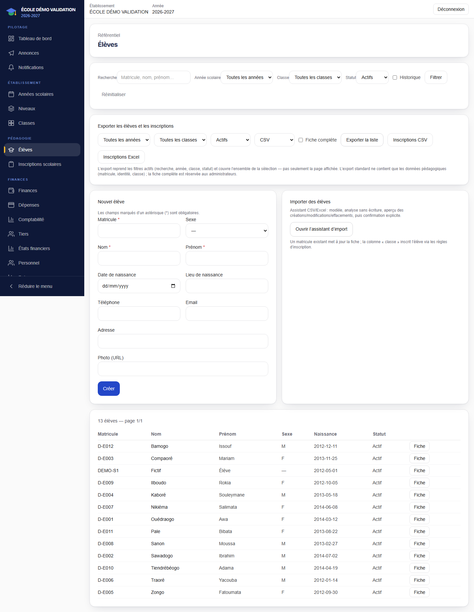

### Encaisser des frais

1. Fiche élève → **Paiement** : montant, méthode, date.
2. Le **reçu numéroté** (`REC-…`) est édité immédiatement.
3. Un envoi en double ne crée jamais de second paiement : le système
   renvoie le reçu déjà émis.

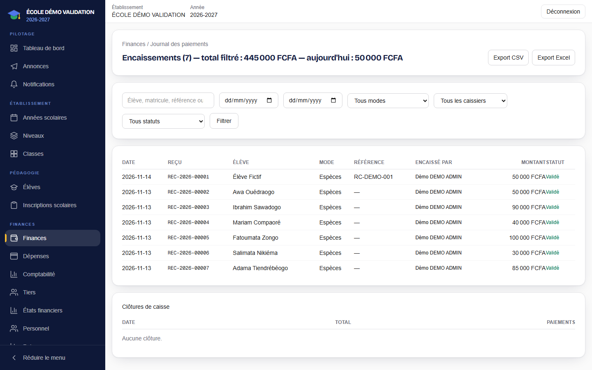

### Suivre les impayés

**Finances → Impayés** liste les soldes restants ; **Relancer** trace la
relance pour le suivi des familles.

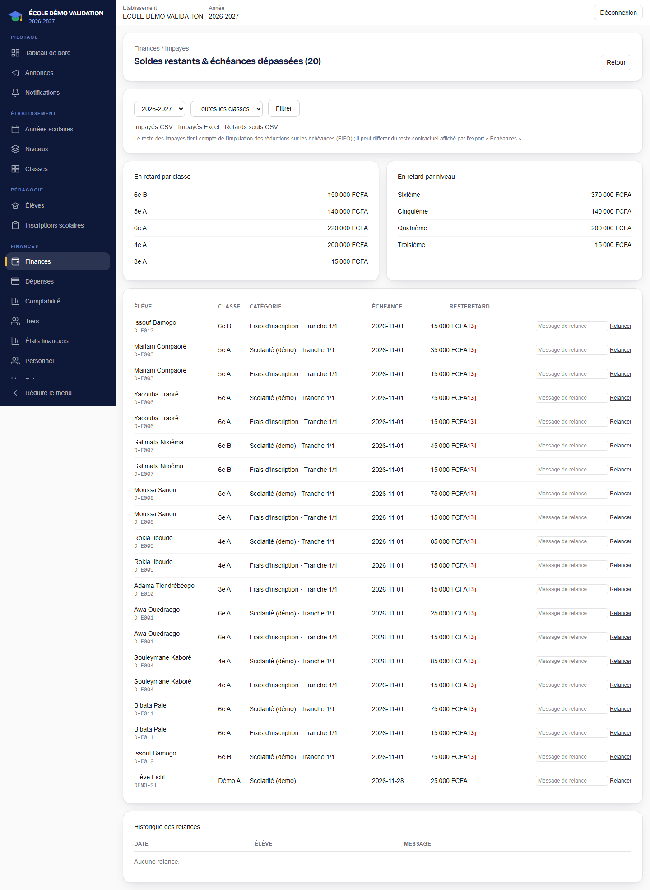

## Comptable

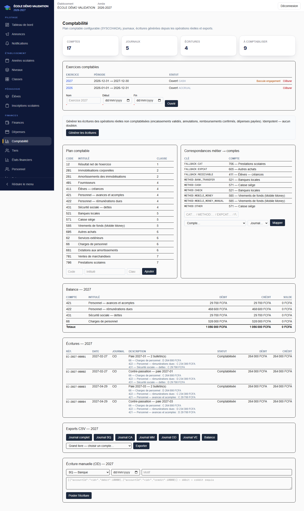

- **Générer les écritures** transforme paiements, dépenses et paie en
  écritures SYSCOHADA équilibrées — aucune double saisie.
- Une écriture ne se modifie pas : on la **contre-passe**.
- **États financiers** : balance, grand livre, **bilan** (actif=passif),
  **compte de résultat**, export CSV.
- **Trésorerie** : suivi et clôture de caisse par journée.

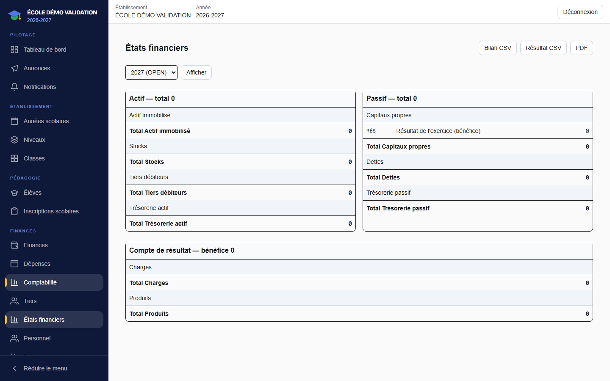

## Responsable RH

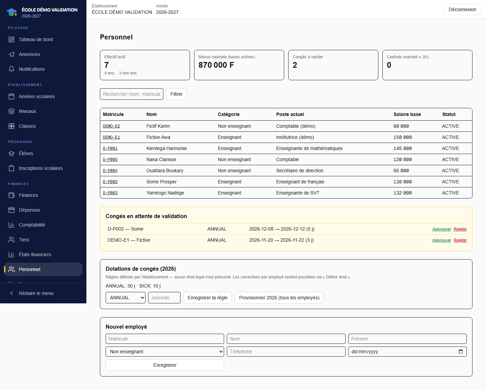

- **Employés** : fiches, contrats (CDI/CDD), départs.
- **Dotations de congés** : l'établissement définit ses règles (jours
  par type et par an) ; les soldes sont provisionnés automatiquement à
  l'activation du contrat. Aucun droit légal n'est présumé.
- **Demandes de congés** : approuver ou refuser — le solde se met à jour.
- **Présences** : pointage du personnel non enseignant.

## Gestionnaire de paie

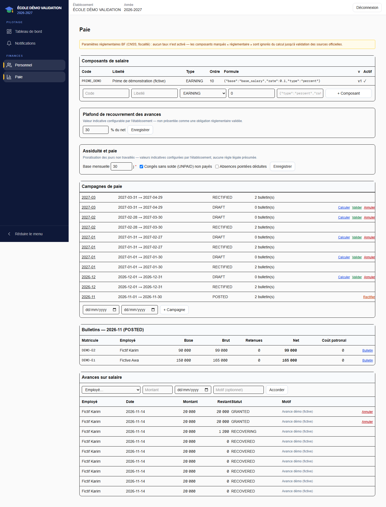

1. **Créer une campagne** (période) → **Calculer** : bulletins
   déterministes — le même calcul refait donne le même résultat.
2. Vérifier un **bulletin** : base, primes, retenues, net à payer, coût
   patronal, jours travaillés.

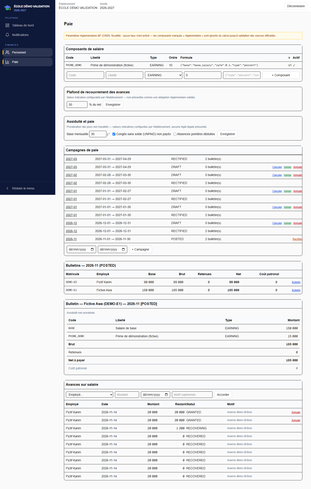

3. **Valider** puis **Comptabiliser** : l'écriture OD est postée — la
   clôture de l'exercice exige cette étape.
4. **Avances** : accord, suivi du restant, **recouvrement plafonné**
   (pourcentage du net décidé par l'établissement — indicatif).
5. **Rectification** : une campagne postée se rectifie par
   contre-passation automatique — l'historique est préservé.

> **Important** : les retenues CNSS et fiscales ne sont pas calculées —
> elles s'activeront après validation du barème officiel burkinabè.

## Enseignant

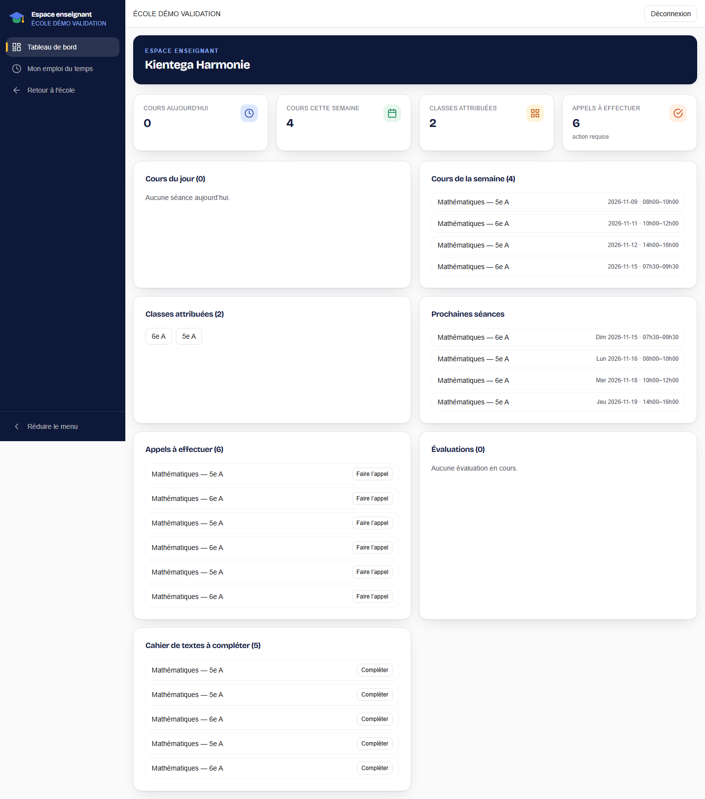

- **Tableau de bord** : cours du jour et de la semaine, classes
  attribuées, appels à effectuer.
- **Faire l'appel** : présents, absents, retards.
- **Cahier de textes** : chapitre, objectif, contenu, devoirs.
- **Évaluations** : saisie des notes de ses classes.

## Parent

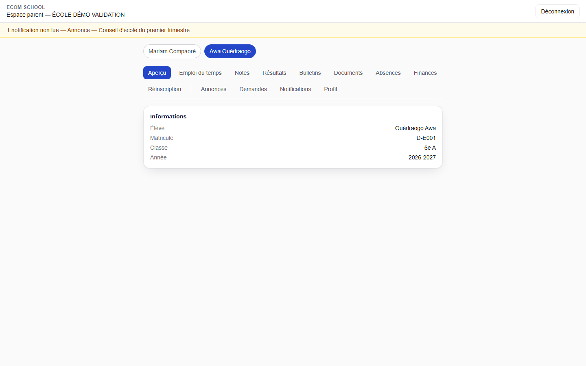

- Sélecteur d'**enfant** en haut de page (un onglet par enfant rattaché).
- **Aperçu** : classe, inscription en cours.
- **Notes** : les évaluations publiées par l'école.

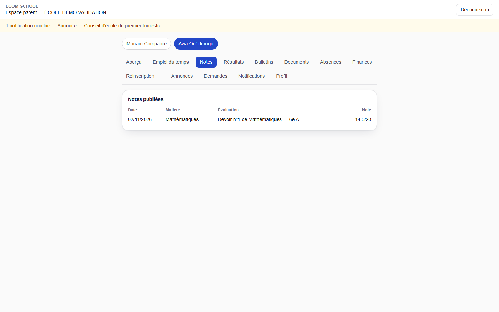

- **Finances** : créances, paiements, **reçus PDF** à télécharger.

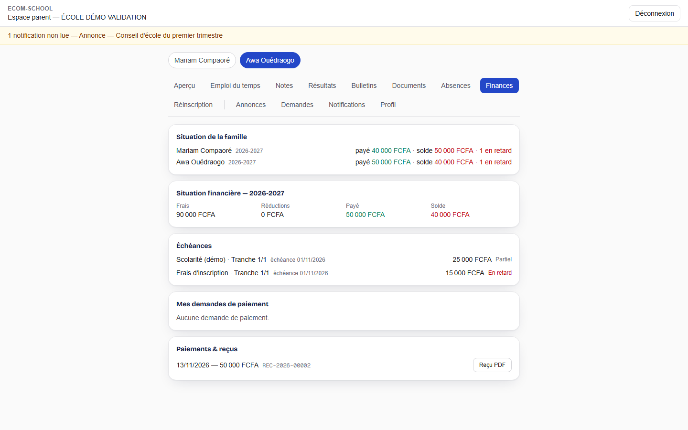

- **Absences** : absences et retards signalés.
- **Annonces / Notifications / Demandes** : communication avec l'école,
  demandes administratives, réinscription.

> Un parent ne voit jamais que **ses propres enfants** — l'accès aux
> autres données est techniquement impossible, pas seulement masqué.
